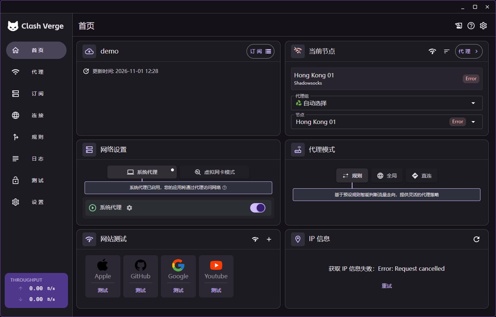
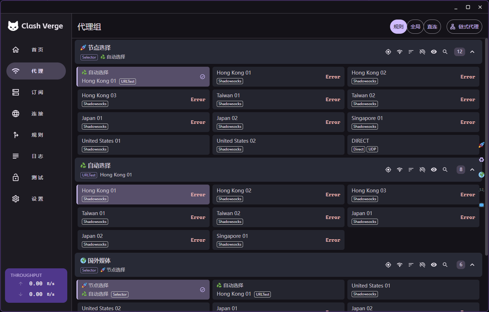
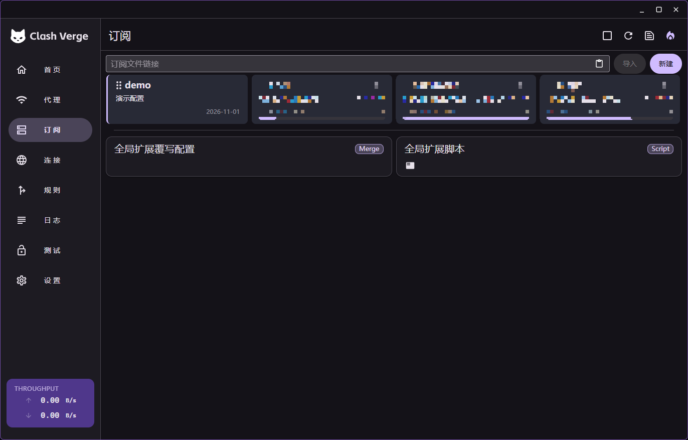
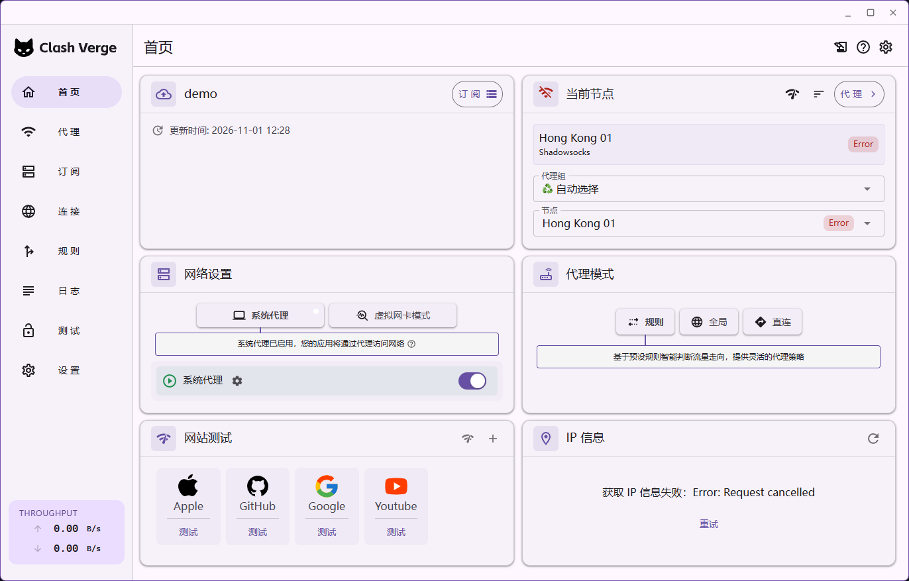
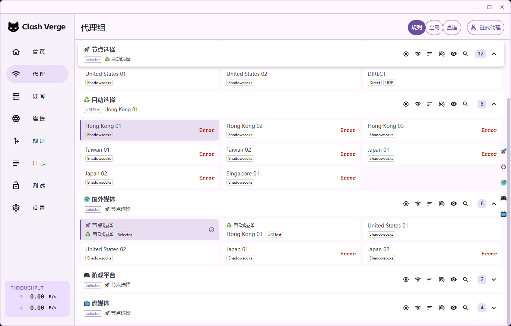
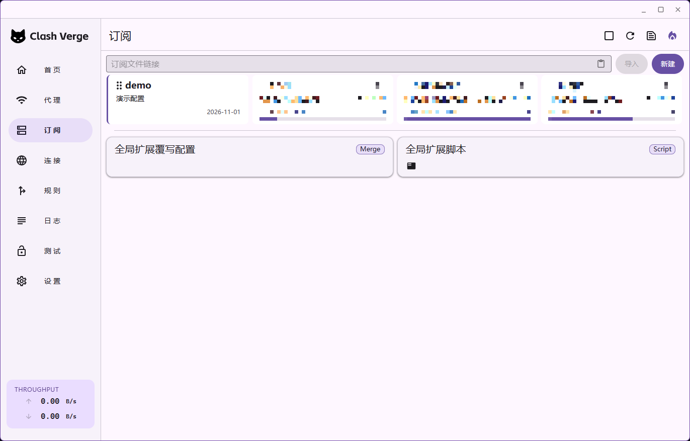
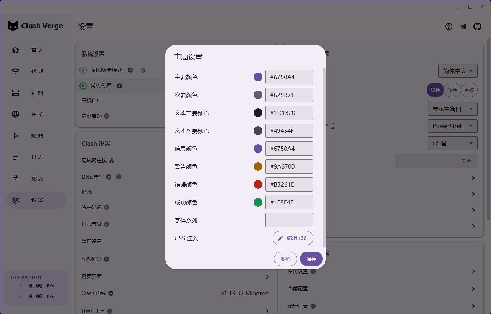

# Clash Verge — Material Design 3 主题

免费开源的 **Clash Verge Rev CSS 主题**，基于 **Google Material Design 3 (M3)** 设计语言，为 Clash Verge 带来统一、现代、克制的视觉风格。

- 深色 / 浅色双主题，跟随系统自动切换
- 全圆角控件、胶囊 Chip、elevation 层级阴影
- 通过 Clash Verge 官方 **CSS Injection** 即可使用，无需改源码

## 主题预览

### 深色模式

| 首页 | 代理 | 订阅 |
|------|------|------|
|  |  |  |

### 浅色模式

| 首页 | 代理 | 订阅 |
|------|------|------|
|  |  |  |

> 截图中的节点均为演示占位数据，不含任何真实节点或订阅信息。

## 使用与配色

### 快速开始（30 秒）

1. 打开 **Clash Verge** → **设置** → **外观设置 / Theme Setting** → **编辑 CSS**
2. 粘贴下面这一行代码
3. 主题模式建议**固定配色**（不选「跟随系统」），并按下方 [配色说明](#配色说明重要) 设置主配色
4. 保存并重启 Clash Verge

```css
@import url("https://cdn.jsdelivr.net/gh/ruixiinn/Clash-Verge-Material3@v1.0.0/dist/clash-verge-material3.css");
```

> 请使用版本标签（如 `@v1.0.0`）或具体 commit，不要用 `@main`，避免 CDN 缓存到旧文件。

### 配色说明（重要）

本主题的**主色 / 状态色由 Clash Verge 的「主题设置」颜色选择器驱动**，不在 CSS 里强制覆盖。请按下表在 **设置 → 主题设置** 中手动填写一次（深色、浅色各填一次）。

主题设置界面如下：



#### 深色模式（Dark）

| 预览 | 设置项 | 色值 |
|------|--------|------|
|  | 主要颜色 | `#D0BCFF` |
|  | 次要颜色 | `#CCC2DC` |
|  | 文本主要颜色 | `#E6E0E9` |
|  | 文本次要颜色 | `#CAC4D0` |
|  | 信息颜色 | `#D0BCFF` |
|  | 警告颜色 | `#F5C25B` |
|  | 错误颜色 | `#F2B8B5` |
|  | 成功颜色 | `#8BD8A0` |

#### 浅色模式（Light）

| 预览 | 设置项 | 色值 |
|------|--------|------|
|  | 主要颜色 | `#6750A4` |
|  | 次要颜色 | `#625B71` |
|  | 文本主要颜色 | `#1D1B20` |
|  | 文本次要颜色 | `#49454F` |
|  | 信息颜色 | `#6750A4` |
|  | 警告颜色 | `#9A6700` |
|  | 错误颜色 | `#B3261E` |
|  | 成功颜色 | `#1E8E4E` |

> 以上色值来自 Google 官方 Material Theme Builder 的 Light/Dark 标准色板，对比度符合 WCAG 无障碍标准。

## 常见问题 FAQ

**Q: 粘贴 `@import` 后没有变化？**  
A: 确认用的是 `dist/*.css` 单文件地址；保存后重启 Clash Verge；检查 CSS 注入框只保留一条 `@import`。

**Q: 为什么不要用 raw.githubusercontent.com？**  
A: GitHub raw 常以 `text/plain` 返回，浏览器可能直接忽略样式。请用 jsDelivr。

**Q: 支持浅色模式吗？**  
A: CSS 已内置两套 M3 色板，但**主色需在「主题设置」里深浅各手动填一次**（深浅主色是分开存储的，不会自动映射）。若只想省事，建议把主题模式**固定为深色**，就不用管浅色配色了。

## 参考

- 设计语言：Google [Material Design 3](https://m3.material.io/)
- emoji 字体：twemoji（CC-BY 4.0）

## License

MIT © contributors
